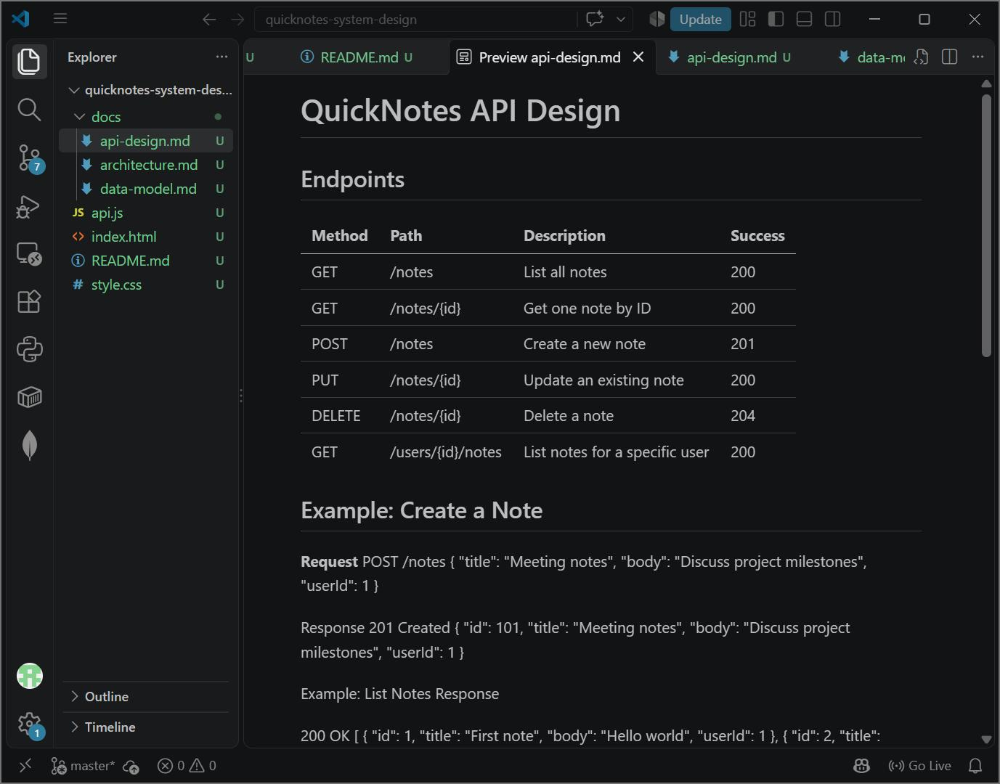
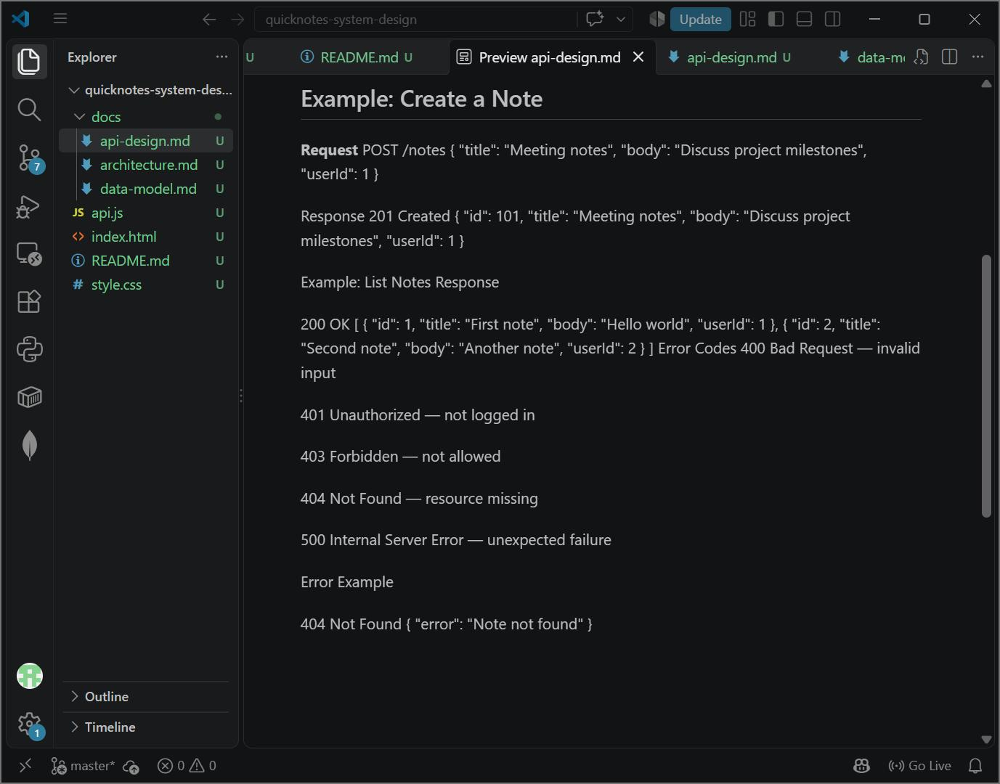
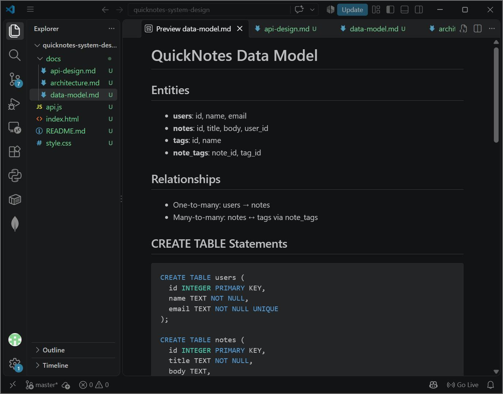
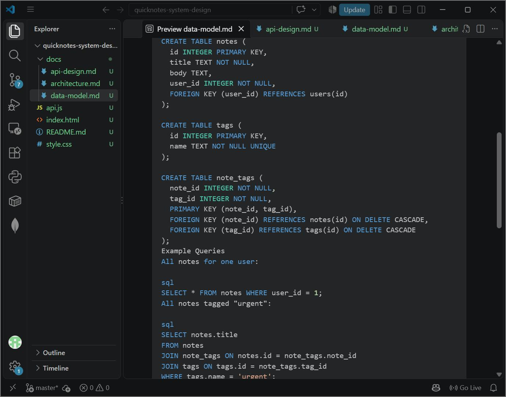
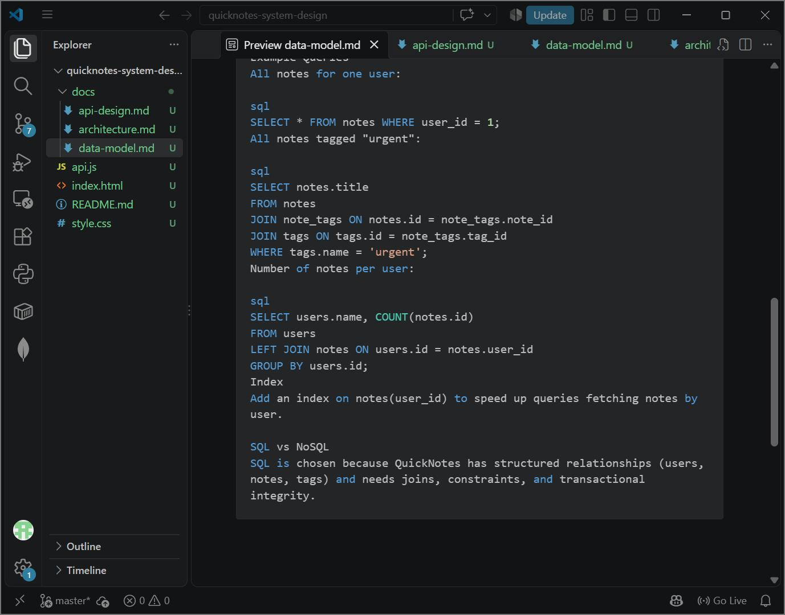
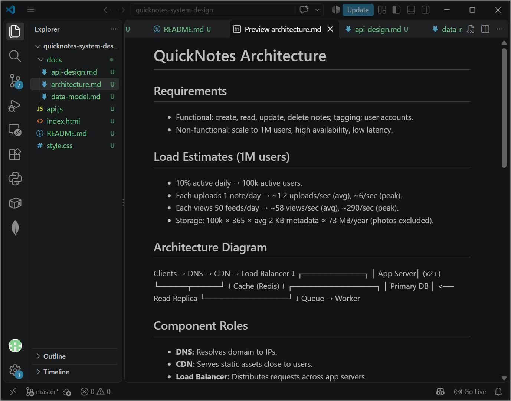
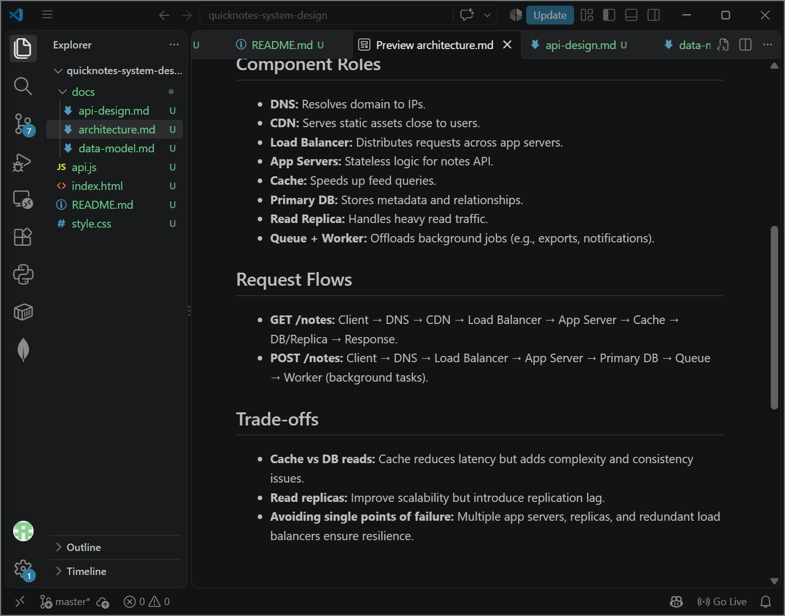

# QuickNotes System Design

## 📌 Description
QuickNotes is evolving from a browser-only app into a real online service for 1 million users.  
This project proves the front end can talk to an API (via JSONPlaceholder) and provides design docs for the backend team.

## 🚀 How to Run
1. Clone the repo:
   ```bash
   git clone https://github.com/your-username/quicknotes-system-design
Open index.html in your browser (use Live Server or double-click).

Use the buttons and form to load, create, and delete notes.

📖 Documents
[Looks like the result wasn't safe to show. Let's switch things up and try something else!]

[Looks like the result wasn't safe to show. Let's switch things up and try something else!]

[Looks like the result wasn't safe to show. Let's switch things up and try something else!]

📸 Screenshots
API Design
  


Data Model
  
  


Architecture
  


Open index.html in your browser (use Live Server or double-click).

Use the buttons and form to load, create, and delete notes.

🌱 What I Learned
How to build a reusable API client with fetch, async/await, and error handling.

Why validation and UI states (loading, success, error, empty) matter for user experience.

How to design REST endpoints, relational data models, and scalable architectures.